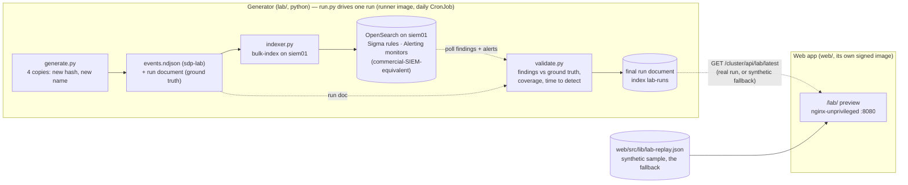

# detection-lab

An incident generator for SIEM training: emulated attacks with a known ground truth, and the
detections that should catch them. The flagship case is polymorphism: every copy of a harmless test
program gets a new hash and a new name, the hash rule misses all but the first, and detection keyed
on behaviour still opens one incident.

**Status: the generator (variant A) and the web app are both here. See [`lab/`](lab/) and
[`web/`](web/).**

This repository is now a full project: the **generator** (`lab/`, python) that writes the events and
the run document, and the **web app** (`web/`, TypeScript) that serves the `/lab/` preview as its own
signed container image. The two share one data shape (`LabReplay`), so the page and a real run line
up one to one.

| What | Where |
|---|---|
| The generator, validator and indexer (python3 stdlib only) | [lab/](lab/) |
| A synthetic replay of scenario C, the labelled sample | [replay/scenario-c.json](replay/scenario-c.json) |
| The web app: the `/lab/` preview, its own nginx image | [web/](web/) |
| The preview, live | https://hubertjablon.ski/lab/ |

## How it fits together



Variant A executes nothing: `generate.py` only writes synthetic JSON (the events a run would
produce, plus the ground truth). The events are indexed into the real SIEM, its own Sigma rules and
Alerting monitors do the detecting, and `validate.py` compares what they caught against the ground
truth. The web app reads a `LabReplay` and computes everything in the browser: it fetches the latest
real run from the cluster API (`/cluster/api/lab/latest`, same origin) and, until that endpoint
answers — and in the standalone image, which has no API — it falls back to the bundled synthetic
sample. The generator writes events in the same shape, so the page and a real run can be compared
one to one.

## The generator (`lab/`)

Python 3 standard library only (it runs on siem01, Debian, no `pip`). Variant A executes no binary;
a real test binary belongs to variant B (an isolated VM), which is out of scope here.

- **`generate.py`** writes one run: `--copies N` (default 4) copies of a harmless marker artefact,
  each with a new SHA-256 and a new file name. Copy 1 is deterministic (a fixed byte blob, constant
  hash) so a hash IOC rule can pin to it; copies 2..N get a fresh random 16-byte marker. For each
  copy it emits a process-create (`event.code` 1), a Run-key write from a Temp path (`13`) and a
  steady beacon (`3`, enough connections for the 5+/10-min logic). Outputs:
  - `events.ndjson` — one event per line in the `sdp-lab` field contract, as nested objects
    (`{"event": {"code": ...}, "process": {...}}`, `@timestamp` top-level): Security Analytics
    rules match nested documents, not flat dotted keys. Ready to bulk-index;
  - `run.json` — the ground-truth / run document in the site's `LabReplay` shape (`schema: 1`,
    `sample: false`), with lab labels only (`ws1`/`ws2`, `lab beacon :<port>`) and findings left
    empty for the validator to fill. Under 64 KiB.
- **`validate.py`** reads `run.json` and the real detections, then fills per-copy `caught_by_hash`
  and each finding's `delay_s`, the `incident` (when a behaviour-keyed alert opens it and after which
  copy), and ATT&CK coverage (expected vs detected). The hash rule catches copy 1 only; the beacon
  monitor opens one incident. It takes either pre-parsed detections (`--findings`) or the raw
  OpenSearch responses straight from the SIEM: `--raw-findings` (a Security Analytics findings
  response) and `--raw-alerts` (an Alerting alerts response). It maps each finding to a run rule by
  the query's ATT&CK tag, keeps only findings whose matched document belongs to this run (so an
  isolated-VM copy from another run is ignored), uses the detector/alert time as the detection time,
  and opens the incident at the copy that first makes two distinct hashes beacon to one address. It
  emits only lab labels, never real hosts/addresses, and stays under 64 KiB.
- **`run.py`** drives one real run end to end, the entrypoint a cluster CronJob invokes
  (`python3 /app/lab/run.py`, no arguments): it generates the events and run document (`generate.py`),
  bulk-indexes the events into `sdp-lab` over mutual TLS (`indexer.py`), **resolves the Security
  Analytics detector id and the Alerting monitor id by name** (the ids are OpenSearch-generated and
  dynamic, so they are discovered at runtime, never hard-coded), polls those findings and alerts for
  the run (by `lab.run_id` and a time window) until the detector and monitor have fired or it times
  out, validates the real detections against the ground truth (`validate.py`), and indexes the final
  run document into the `lab-runs` index. There is **one identity**: the `lab-runner` client
  certificate carries every permission the run needs (write `sdp-lab`, read the detector's findings
  and the monitor's alerts, write `lab-runs`), so it serves indexing, polling and publishing alike.
  The environment contract (no secrets in the file; `--flags` mirror every variable):
  - required: `SIEM_URL`, `SIEM_CLIENT_CERT`, `SIEM_CLIENT_KEY`, `SIEM_CA_CERT`;
  - optional, defaulted so the CronJob need not set them: `LAB_MODE` (`generated`), `LAB_STREAM`
    (`sdp-lab`), `LAB_RUNS_INDEX` (`lab-runs`), `LAB_DETECTOR_NAME` (`sdp-lab-rules`),
    `LAB_MONITOR_NAME` (`sdp-git: lab-polymorphic-beacon`).

  It exits non-zero on any failure (including a detector/monitor name that resolves to no, or more
  than one, document). The contract is frozen by a test (`test/test_lab.py`) against its counterpart
  manifest `cluster/infra/lab/cronjob.yaml` in the self-defending-portfolio repository, so the two
  cannot drift silently.
- **`indexer.py`** bulk-POSTs `events.ndjson` into an OpenSearch data stream over mutual TLS
  (`--cert`/`--key`, the `lab-runner` identity on siem01). Bulk `create` with no `_id`, as a data
  stream requires. No credentials in the file.

Example:

```sh
python3 lab/generate.py --out ./out
python3 -m unittest discover -s test -p 'test_*.py'
```

Detection content (the Sigma rules and the Alerting monitor) lives in the self-defending-portfolio
`siem/` tree; the SIEM is a commercial-SIEM-equivalent OpenSearch instance with Security Analytics.

### The runner image (`runner/`)

`run.py` ships as its own signed container image, `ghcr.io/hubertmj/detection-lab/lab-runner`, so a
cluster CronJob can drive the daily run without a Python toolchain on the node. The base is
distroless `python3` (nonroot, no shell, read-only root) pinned by tag *and* digest; because `run.py`
is standard library only, nothing else is installed and the image stays tiny.
[`.github/workflows/build-runner.yml`](.github/workflows/build-runner.yml) runs the `unittest` suite
on every PR, then on `main` builds the image, gates it with Trivy (fixable CRITICAL/HIGH fail the
build), emits an SPDX SBOM and signs the image and SBOM with cosign keyless — the same pipeline as
the web image. The two share one detection-lab workflow identity, so the cluster's Kyverno policy
trusts both. The image bakes in no endpoints or secrets: the CronJob supplies them through
`SIEM_*`/`LAB_*` environment variables and mounts the single `lab-runner` client certificate.

## The web app (`web/`)

The `/lab/` preview, a static page served by its own hardened nginx image. It is built, scanned,
SBOM'd and signed exactly like the landing site: a two-stage Dockerfile (esbuild bundle + unit tests,
then `nginx-unprivileged` on `:8080`, read-only, uid 101), and
[`.github/workflows/build-image.yml`](.github/workflows/build-image.yml) runs Playwright on every
PR, then on `main` builds the image, gates it with Trivy (fixable CRITICAL/HIGH fail the build),
emits an SPDX SBOM and signs the image and SBOM with cosign keyless. The image is
`ghcr.io/hubertmj/detection-lab/lab`; the cluster's Kyverno admits it only with that signature.

- Everything the image serves lives under the `/lab/` prefix (`/lab/` for the page,
  `/lab/assets/` for the content-hashed bundles), so it never collides with the landing site on the
  same origin.
- The Content-Security-Policy is character-for-character the landing site's: `default-src 'none'`,
  `style-src 'self'`, Trusted Types enforced (no inline styles, no `innerHTML`), and
  `connect-src 'self'` so the page can call `/cluster/api/lab/latest` same-origin.
- The page keeps the bundled `src/lib/lab-replay.json` as the labelled synthetic-sample fallback.
  When `/cluster/api/lab/latest` answers with a valid real run (`sample: false`), the page draws it
  instead and labels it by mode: a generated run reads "events generated, detection real", an
  isolated-VM run "a real run in an isolated lab", each shown with the run date (`run.finished_at`).
  Only the fallback carries the "Synthetic sample" label. The label is the only visible difference;
  everything else the page computes in the browser from the same `LabReplay` shape.

```sh
cd web
npm ci --ignore-scripts
npm run lint        # tsc --noEmit
npm test            # vitest (the replay model)
npm run build       # -> dist/lab/
npm run test:e2e    # Playwright against the built, served page
```

## Decisions (2026-10-14)

- The Windows lab (GOAD) is not built on the current hardware: it needs roughly 28-36 GB of RAM.
- The SIEM is the OpenSearch instance of
  [self-defending-portfolio](https://github.com/HubertMJ/self-defending-portfolio) (Security
  Analytics with Sigma rules, Alerting monitors).
- Copies are renamed by default, not only rebuilt: a real attacker changes the name too. Risk
  scored per program name never reaches the threshold; scored per behaviour (the address every
  copy calls) it opens one incident at the second copy.
- A synthetic replay is the possible next step: the generator writes Sysmon-format events
  (`replay/`) that can be indexed into OpenSearch without any Windows machine.

## The replay format

`replay/scenario-c.json` (`schema: 1`, `sample: true`): the artefact, the beacon address, the risk
threshold, the rules with their score and ATT&CK technique, and four variants. Each variant has its
host, SHA-256, renamed file name, Sysmon-style events (`event.code` 1, 3, 13), ground truth and the
findings each rule would raise, with the delay to detection. Every value is generated; no machine
ran it.

## License

MIT, see [LICENSE](LICENSE). Planned dependencies keep their own licenses (GOAD GPL-3.0,
Sigma rules DRL 1.1) and are to be used as submodules, not copied.
